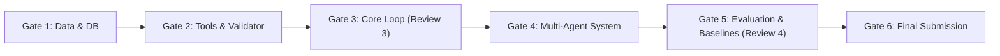

# SkyMediator — Acceptance Criteria and Quality Gates

**Document Version:** 1.0.0  
**Status:** Under Architectural Review  
**Date:** 26 October 2026  
**Project:** Agentic AI (26CD7PEAAI), B.E. CSE (Data Science), BMSCE  
**Authors:** Athish Raj, Dinesh K, Sanchit Rajesh  
**Instructor:** Dr. Kalyan Nagaraj  

---

## 1. Quality Gates Overview

The development of SkyMediator is governed by six strict quality gates aligned with the BMSCE course milestones (Review 3 on 31 October, Review 4 on 7 November, Final Submission on 12 November).

---

## 2. Gate 1: Data Ingestion and Synthetic Generation

| Item ID | Criterion | Verification Method | Pass/Fail Condition |
| :--- | :--- | :--- | :--- |
| **AC-1.1** | **Data Feasibility Sign-off** | Feasibility report in `data/feasibility_note.md` | Approved primary airport (DEL) or fallback (ORD) with confirmed METAR & schedule source. |
| **AC-1.2** | **One-Command Identical DB Build** | Run `python -m ingest.make_scenarios --seed 42` twice on clean directories | `fc /b skymediator_1.db skymediator_2.db` or SHA-256 hash match 100%. |
| **AC-1.3** | **Relational Integrity** | SQLite foreign key checks | `PRAGMA foreign_key_check;` returns 0 violations. |
| **AC-1.4** | **Scenario Seeding** | 5 standard disruption scenarios and 5 adversarial scenarios seeded | SQLite table `scenarios` contains at least 10 valid scenario records. |

---

## 3. Gate 2: Deterministic Tools and Independent Validator

| Item ID | Criterion | Verification Method | Pass/Fail Condition |
| :--- | :--- | :--- | :--- |
| **AC-2.1** | **Deterministic Arithmetic** | Code audit of all files in `agents/` and `graph/` | Zero arithmetic operations (`+`, `-`, `*`, `/`) applied to operational quantities by LLM prompts. |
| **AC-2.2** | **FDTL Calculation Fidelity** | Unit tests in `tests/test_duty.py` against 10 hand-worked examples from CAR Section 7 | 100% exact match on FDP minutes, night duty penalties, and minimum rest. |
| **AC-2.3** | **Slot & Turnaround Logic** | Unit tests in `tests/test_schedule.py` and `tests/test_slots.py` | Detects turnaround $< \text{min\_turn\_min}$ and window movement overflow with 100% precision. |
| **AC-2.4** | **Clean-Room Independent Validator** | `eval/validator_fdtl.py` verification | Operates independently of `tools/duty.py`. Test suite confirms validator flags deliberate violations. |
| **AC-2.5** | **Zero Circular Dependency** | Grep check across `agents/` and `graph/` | `eval/validator_fdtl.py` is never imported by any runtime agent or tool. |

---

## 4. Gate 3: Core Deliberation Loop (Review 3 Target — 31 October)

| Item ID | Criterion | Verification Method | Pass/Fail Condition |
| :--- | :--- | :--- | :--- |
| **AC-3.1** | **Minimal Vertical Slice Execution** | Run `python -m app.cli --scenario SCENARIO_FOG_01 --smoke-test` | System executes: Disruption -> Proposal -> Veto -> Counter-proposal -> Candidate Plan. |
| **AC-3.2** | **Hard Veto Enforcement** | Inject an intentionally illegal crew swap | Crew Legality agent issues `VETO`; plan is excluded from surviving candidate pool. |
| **AC-3.3** | **Agentic RAG Self-Correction** | Inject ambiguous query in crew agent RAG test | Agent detects relevance $< 0.70$, rewrites query, and retrieves correct clause or abstains. |
| **AC-3.4** | **Observability Trace Emission** | Check `traces/` after run | Valid JSONL file produced containing `TraceSpan` records for every step. |

---

## 5. Gate 4: Multi-Agent System and Human Interrupt

| Item ID | Criterion | Verification Method | Pass/Fail Condition |
| :--- | :--- | :--- | :--- |
| **AC-4.1** | **Bounded Deliberation Loop** | Test with non-converging proposals | System terminates strictly at Round 3 or when token budget is reached. Never loops indefinitely. |
| **AC-4.2** | **Normalized Multi-Objective Scoring** | Compare candidate scores in `tools/scoring.py` | Composite score bounded in $[0, 1]$; higher delay or cost strictly increases penalty. |
| **AC-4.3** | **LangGraph Approval Interrupt** | Graph execution reaches final state | Graph execution pauses with `interrupt()`. State contains full candidate matrix awaiting input. |
| **AC-4.4** | **Duty Manager Action Processing** | Submit `APPROVE`, `REJECT`, or `SELECT_ALTERNATIVE` via CLI | Graph resumes, records manager signature, and saves final plan. |
| **AC-4.5** | **Mandatory Escalation Triggers** | Test scenario with 2 plans differing in score by $2\%$ or with missing data | State transitions to `status: "ESCALATED"` with cited escalation reason. |

---

## 6. Gate 5: Evaluation Harness and Baselines (Review 4 Target — 7 November)

| Item ID | Criterion | Verification Method | Pass/Fail Condition |
| :--- | :--- | :--- | :--- |
| **AC-5.1** | **Independent Rule Compliance** | Run `eval/run_eval.py` on 25 scenarios | Recommended approved plans exhibit **0.00%** FDTL violations according to `validator_fdtl.py`. |
| **AC-5.2** | **Comparative Baselines** | Compare Multi-Agent against Greedy Baseline and OR-Tools Solver | Multi-Agent achieves $\ge 85\%$ of OR-Tools cost optimality while providing full natural-language explainability. |
| **AC-5.3** | **RAG Gold Set Retrieval Recall** | Run `eval/run_eval.py --rag-eval` against 50 gold question-clause pairs | Clause Recall@3 $\ge 90\%$, Citation Precision $\ge 95\%$. |
| **AC-5.4** | **Statistical Rigor** | 10 repeated runs per scenario with bootstrap CI | Paired Wilcoxon signed-rank tests reported with $p < 0.05$ and Cohen's $d$. |

---

## 7. Gate 6: Final Submission and Delivery (12 November)

| Item ID | Criterion | Verification Method | Pass/Fail Condition |
| :--- | :--- | :--- | :--- |
| **AC-6.1** | **Clean Repository Tree** | Verify against Section 10 of specification | Directory layout matches `data/`, `ingest/`, `tools/`, `agents/`, `graph/`, `eval/`, `traces/`, `app/`. |
| **AC-6.2** | **End-to-End Documentation** | Verify `README.md` and user guide | A new developer can clone, install requirements, seed DB, run tests, and launch the OCC demo in $< 10$ minutes. |
