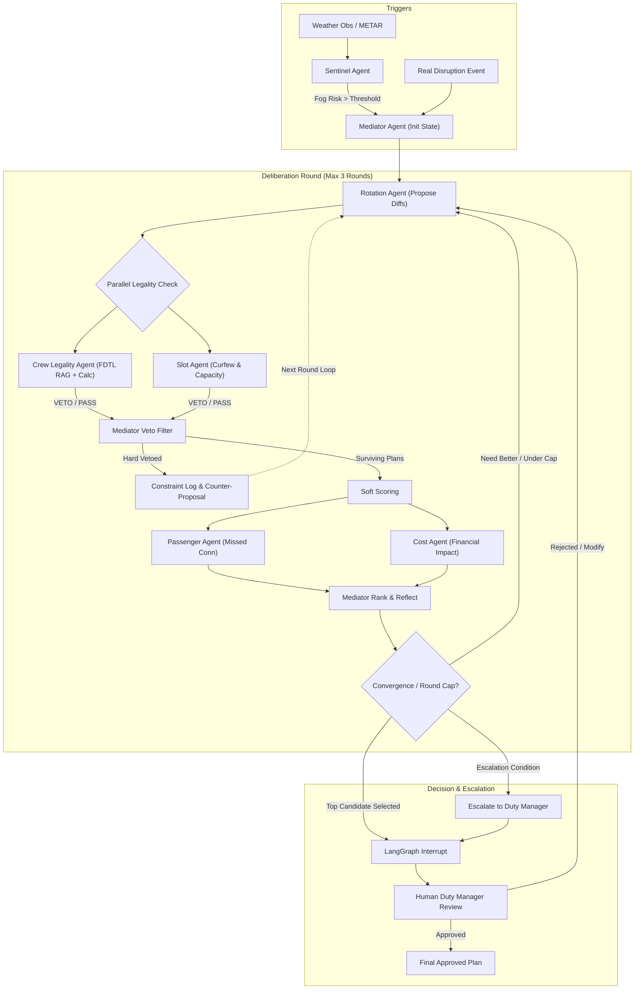
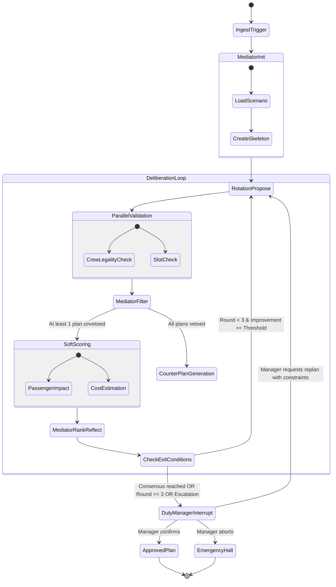

# SkyMediator — Architecture Review & Gap Analysis

**Document Version:** 1.0.0  
**Status:** Under Architectural Review  
**Date:** 26 October 2026  
**Project:** Agentic AI (26CD7PEAAI), B.E. CSE (Data Science), BMSCE  
**Authors:** Athish Raj, Dinesh K, Sanchit Rajesh  
**Instructor:** Dr. Kalyan Nagaraj  

---

## 1. Executive Summary

This document performs an exhaustive architectural audit of the initial *Predictive Multi-Agent System for Airline Disruption Recovery* specification (`design_document-1.pdf`, 26 October 2026). It extracts the intended design, rigorously identifies architectural gaps, contradictions, and ambiguities, and provides an authoritative blueprint for implementation in LangGraph and Python.

---

## 2. Intended Design Extraction (Step 1)

### 2.1 Problem Statement and Operational Scope
SkyMediator addresses hub-level airline disruption management (primarily winter fog causing low-visibility procedures and secondary AOG events). It models:
- **Scope Limits:** 1 hub airport, 24-hour tactical planning window, approximately 15 aircraft in a closed rotation pool, and 40–80 scheduled flights.
- **Decision Focus:** Evaluates candidate recovery plans (swaps, delays, cancellations, crew deadheading) and recommends the optimal plan to a human duty manager.
- **Core Role:** Advisory decision-support system. Final authority rests entirely with the human duty manager via an approval pause.

### 2.2 System Components and Responsibilities
The system decomposes disruption recovery across seven specialized agents and a human supervisor:
1. **Sentinel Agent (Advisory):** Forecasts fog risk and disruption onset using weather features and a trained ML classifier.
2. **Rotation Agent (Proposer):** Formulates recovery actions (aircraft swaps, schedule delays, selective flight cancellations) represented as diff operations.
3. **Crew Legality Agent (Hard Veto):** Validates crew flight duty limits against DGCA CAR Section 7, Series J, Part III using deterministic calculations and Agentic RAG clause retrieval. Holds absolute veto power.
4. **Slot Agent (Hard Veto):** Validates airport arrival/departure slot capacity and night curfew constraints. Holds absolute veto power.
5. **Passenger Agent (Scorer):** Evaluates passenger impacts, counting broken connections and identifying available seat rebooking paths.
6. **Cost Agent (Scorer / Proposer):** Prices candidate plans deterministically across delay penalties, cancellation costs, and DGCA mandatory passenger care liabilities (meals, accommodation, compensation).
7. **Mediator Agent (Coordinator / Decider):** Drives the multi-agent deliberation rounds, enforces hard veto filtering, computes composite multi-objective scores, reflects on unhandled constraints, and escalates edge cases.
8. **Duty Manager (Human-in-the-Loop):** Reviews candidate comparison matrices, evidence citations, and confirms, rejects, or modifies the recommended plan.

### 2.3 Agent Interactions and Deliberation Flow

### 2.4 Data Sources and Deterministic Tooling
- **Real Sources:** DGCA/BTS flight schedules, IEM/NOAA METAR archives, OpenSky movement data, DGCA CAR regulatory PDFs.
- **Synthetic Generators:** Seeded generators anchoring crew pairings, passenger bookings, and ticket itineraries to real flight IDs.
- **Tool Suite:** 14 deterministic calculation/query tools + 2 non-deterministic tools (`retrieve_fdtl` vector RAG and `fog_risk_model` ML classifier).

---

## 3. Gap Analysis and Contradiction Audit (Step 2)

The initial design document contains multiple critical gaps, underspecified schemas, and operational ambiguities that must be resolved prior to coding.

### Table of Findings

| ID | Finding Category | Severity | Description and Impact | Evidence in Initial Specification | Recommended Resolution |
| :--- | :--- | :--- | :--- | :--- | :--- |
| **GAP-01** | Undefined Schema | **High** | `plan_diff` operations are only vaguely illustrated as pseudo-code (`swap_tail\|delay\|cancel...`). Without an explicit schema, agents cannot formulate valid operations, and tools cannot apply diffs. | Page 2 & 4: `plan_diff: [{"op": "...", ...}]` without typed fields. | Formalize `PlanDiffOp` as a discriminated union in Pydantic: `SwapTailOp`, `DelayOp`, `CancelOp`, `RepositionCrewOp`. Create a deterministic tool `apply_plan_diff`. |
| **GAP-02** | Signature Mismatch | **High** | Tool input parameters are inconsistent. Table 4 specifies `calc_duty_time(crew_id, plan)` taking a full plan, but `check_slot(plan_diff)` taking only the diff. | Page 5, Table 4: `calc_duty_time` vs `check_slot` input types. | Standardize all evaluation tools to operate consistently on either candidate plan state or unified `PlanDiff` + base state. |
| **GAP-03** | Architectural Contradiction | **Critical** | Page 1 states the Mediator "reflects: does the top plan break any constraint no agent checked? If so it re-plans." Table 4 specifies `validate_plan_independent`: "Evaluation only; agents must not call it." If the Mediator validates constraints, it either duplicates agent checks or violates the non-circularity rule. | Page 1, Section 2 vs Page 5, Table 4. | Clarify Mediator reflection: The Mediator reflects exclusively on *cross-agent trade-offs* (e.g., did a swap save delay but strand 80 high-fare international passengers?) and soft score consistency, and MUST NOT call `validate_plan_independent`. |
| **GAP-04** | Role Ambiguity | **Medium** | Page 1 states "Rotation and Cost propose changes." Page 3 states Cost "Prices each plan... may propose cheaper options." If Cost also generates candidate diffs, it creates race conditions and role overlap with Rotation. | Page 1, Section 2 vs Page 3, Table 1. | Designate Rotation as the sole generator of aircraft/flight operational diffs. Cost acts as an evaluator and advisor, emitting cost-reduction hints (e.g., "flight 104 cancellation penalty exceeds delay penalty by 4x") back to Rotation for the next round. |
| **GAP-05** | Undefined Database Entities | **High** | Database tables in Table 3 lack primary keys, foreign keys, and relational normalization. Storing `flight_ids` as an unnormalized field in `crew_pairings` breaks relational querying. | Page 5, Table 3. | Decompose `crew_pairings` into normalized relational tables: `crew_members`, `crew_duties`, and a junction table `crew_duty_flights`. Add explicit SQL schema with constraints and indices. |
| **GAP-06** | Score Normalization Failure | **High** | Mediator scoring formula `score = w1 delay + w2 missed connections + w3 cost + w4 crew buffer penalty` uses raw unnormalized values. Cost in rupees/dollars ($10^5$) will mathematically dwarf delay minutes ($10^2$) and missed connections ($10^1$). | Page 1, Section 2: `score = w1 delay + ...` | Define min-max or z-score normalized cost functions where each metric is mapped to $[0, 1]$ before applying user-configurable weights $\sum w_i = 1.0$. Explicitly declare whether score is minimized (cost) or maximized (utility). |
| **GAP-07** | Infeasible Data Assumption | **High** | The document lists DGCA schedule pages as UNVERIFIED. In reality, DGCA India does not publish machine-readable flight-level delay/cancellation data with tail numbers, and OpenSky has spotty Indian ADS-B coverage. | Page 4, Table 2 & Page 6, Section 12. | Execute Step 0 feasibility check. Use BTS (Bureau of Transportation Statistics) data as the tested, reproducible flight/tail backbone, while applying DGCA FDTL and passenger rules, or use pre-compiled Indian airline schedules with synthetic tail tracking. |
| **GAP-08** | Regulatory Ambiguity | **Medium** | DGCA CAR Section 7 Series J Part III had revised norms (January 2024 with 48h rest, night duty restrictions) which were subsequently deferred by DGCA. Which version is in force? | Page 3, Section 6.1 & Page 6, Section 12. | Pin the primary regulatory index to DGCA CAR 2019 baseline (in active commercial operation), and parameterize the 2024 revision as a testable policy toggle. |
| **GAP-09** | Missing Failure Handling | **High** | Undefined behavior for critical failure paths: (a) all candidate plans vetoed, (b) RAG retrieval failure, (c) human duty manager rejects the plan during LangGraph interrupt. | Entire document; escalation criteria mentioned but failure loops omitted. | Formulate deterministic fallback workflows: fallback to base operational schedule with maximum delay, human override interface, and auto-abstain on ambiguous retrieval. |
| **GAP-10** | Missing RAG vs Calc Boundary | **Medium** | Table 4 defines `calc_duty_time` (deterministic) and `retrieve_fdtl` (vector search). What does the Crew Agent do if the calculation tool detects a breach vs when RAG is queried? | Page 3, Section 3 & Table 4. | Define exact boundary: `calc_duty_time` computes raw flight duty period (FDP), block hours, rest hours, and WOCL overlap. `retrieve_fdtl` fetches the exact statutory clause governing that scenario. The LLM verifies clause applicability and drafts the structured veto citation. |

---

## 4. Separation of Facts, Assumptions, and Recommendations

### 4.1 Verified Facts
1. LangGraph natively supports cyclic state machines, conditional routers, and human-in-the-loop interrupts (`interrupt()`).
2. DGCA CAR Section 7, Series J, Part III explicitly defines limits on Flight Duty Periods (FDP) based on duty start times and number of landings.
3. DGCA CAR Section 3, Series M, Part IV mandates passenger care (refreshments, hotel accommodation, and statutory compensation for delays and cancellations).
4. Deterministic Python functions prevent arithmetic hallucination and provide verifiable execution traces.

### 4.2 Architectural Assumptions
1. A fleet of 15 aircraft over 24 hours produces between 40 and 80 flights, a volume small enough for in-memory LangGraph state yet complex enough to yield combinatorial rotation options.
2. Synthetic crew rosters and passenger bookings anchored to real flight numbers provide valid operational test scenarios without requiring proprietary airline data.
3. A local vector database (FAISS or ChromaDB) running small dense embeddings (`all-MiniLM-L6-v2`) is sufficient to retrieve specific FDTL clauses from DGCA documents.

### 4.3 Proposed Architectural Enhancements (Requiring Approval)
1. **Proposal 1 (Deterministic Plan Mutation Tool):** Introduce `apply_plan_diff(base_flights, plan_diff)` as an explicit core tool that deterministically generates new flight schedules from diffs before validation.
2. **Proposal 2 (Normalized Scoring Function):** Implement a normalized penalty minimization score:
   $$\text{Penalty} = w_1 \left(\frac{\text{Delay}}{\text{MaxDelay}}\right) + w_2 \left(\frac{\text{MissedPax}}{\text{TotalPax}}\right) + w_3 \left(\frac{\text{Cost}}{\text{BudgetCap}}\right) + w_4 \left(\frac{\text{CrewBufferPenalty}}{\text{MaxBuffer}}\right)$$
3. **Proposal 3 (Escalation & Rejection State Machine):** If the duty manager rejects the recommended plan at the interrupt, the state machine transitions to an interactive replan node where the manager inputs specific constraints (e.g., "do not cancel flight 102").

---

## 5. LangGraph Orchestration State Machine

The orchestration graph is implemented as a versioned `StateGraph`:

### State Transitions and Edge Logic
1. **`router_after_init`:** Evaluates disruption severity. If no disruption, exits immediately. Otherwise enters `RotationPropose`.
2. **`parallel_validation`:** Dispatches `CrewLegality` and `Slot` agents concurrently across all candidate plans in `plan_state["candidates"]`.
3. **`router_veto_filter`:**
   - If *all* candidates are vetoed: increments round; if `round < 3`, sends veto constraints to `RotationPropose` for counter-proposals; if `round == 3`, triggers immediate `Escalation`.
   - If *at least one* candidate survives: transitions to `Passenger` and `Cost` scoring.
4. **`router_exit_evaluation`:**
   - If `round >= 3` OR score delta $< 0.01$ OR escalation flag is set: routes to `DutyManagerInterrupt`.
   - Else: increments `round` and loops back to `RotationPropose`.
5. **`DutyManagerInterrupt` (`interrupt()`):** Halts graph execution. Serializes state to disk. Resumes upon duty manager input (`APPROVE`, `REJECT`, `OVERRIDE`).
